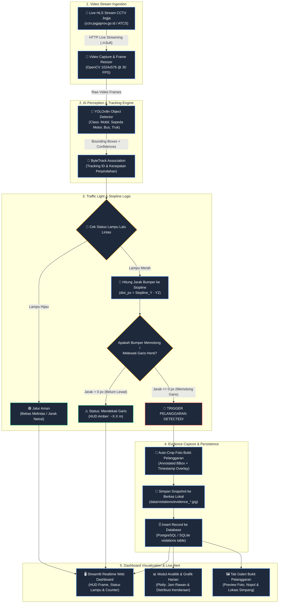
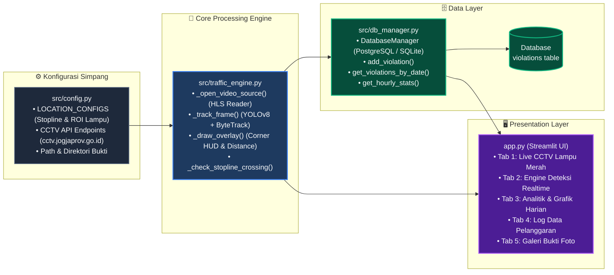
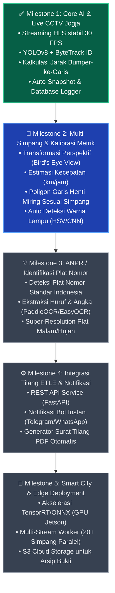

# Roadmap Detailed — Traffic Light Violation Detection System
**Yogyakarta Smart City & ATCS Edition**

---

## 1. Diagram Alur Sistem End-to-End

Berikut adalah alur pergerakan data dari video feed CCTV ATCS Yogyakarta hingga masuk ke basis data dan dashboard pemantauan Anda:

---

## 2. Diagram Interaksi Siklus Hidup Deteksi Pelanggaran (Violation Lifecycle)

Diagram interaksi berikut menunjukkan bagaimana sebuah kendaraan dipantau dari saat pertama kali memasuki kamera hingga pencatatan bukti tilang:

```mermaid
sequenceDiagram
    autonumber
    actor Kendaraan as 🚗 Kendaraan di Simpang
    participant CCTV as 📹 CCTV ATCS Jogja
    participant Engine as ⚙️ TrafficViolationEngine
    participant YOLO as 🧠 YOLOv8 + ByteTrack
    participant Logic as 📏 Stopline & Light Logic
    participant DB as 🗄️ Database (PostgreSQL)
    participant UI as 🖥️ Dashboard Streamlit

    Kendaraan->>CCTV: Melintas di area persimpangan
    loop Setiap Frame Video (30 FPS)
        CCTV->>Engine: Stream HLS Video Chunk (.ts)
        Engine->>YOLO: Kirim frame citra (1024x576)
        activate YOLO
        YOLO-->>Engine: Hasil deteksi: Bounding Box [x1, y1, x2, y2] + ID unik
        deactivate YOLO
        
        Engine->>Logic: Evaluasi: Posisi Y bumper vs Garis Henti & Status Lampu
        
        alt Status Lampu: HIJAU
            Logic-->>Engine: Aman (Jalur Hijau)
            Engine->>UI: Render kotak deteksi HIJAU + Label Jarak
        else Status Lampu: MERAH & Jarak > 0 meter
            Logic-->>Engine: Peringatan (Mendekati Garis Henti)
            Engine->>UI: Render kotak deteksi ORANYE + Label Jarak (~2.5m)
        else Status Lampu: MERAH & Jarak <= 0 meter (Melanggar Garis)
            rect rgb(45, 20, 20)
                Logic-->>Engine: PELANGGARAN TERKONFIRMASI!
                Engine->>Engine: Crop frame bukti & render watermark teks
                Engine->>DB: INSERT INTO violations (timestamp, location, vehicle_type, vehicle_id, evidence_path)
                DB-->>Engine: Record tersimpan (ID: #102)
                Engine->>UI: Render kotak deteksi MERAH (LEWAT GARIS MELANGGAR!)
                Engine->>UI: Update Live Counter Pelanggaran (+1)
                Engine->>UI: Tambahkan foto bukti ke Galeri Pelanggaran
            end
        end
    end
```

---

## 3. Diagram Arsitektur Komponen Sistem (Component & Data Flow)

Diagram berikut memetakan keterhubungan antar modul kode sumber di dalam proyek:

---

## 4. Rencana Tahapan Rilis (Milestones & Roadmap)

